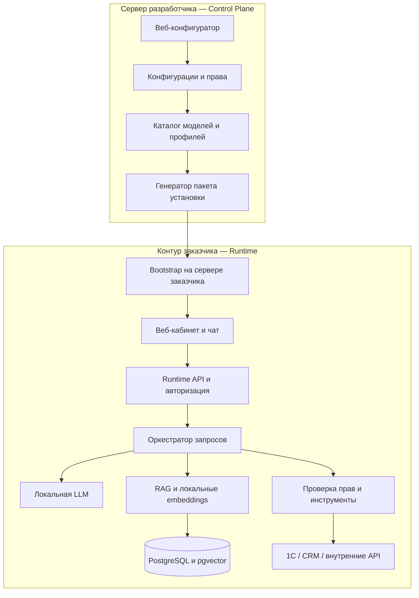

# On-Prem RAG Platform

**Платформа конфигурации и автоматизированного развертывания локальных AI-ассистентов для бизнеса.**

Дипломный проект: веб-конструктор, который связывает локальную языковую модель с документами и корпоративными API, помогает выбрать аппаратный профиль и формирует пакет установки на сервер заказчика.

> **Статус: первый прототип.** Реализован локальный CRUD-симулятор бизнес-API с синтетическими данными, SQLite, Swagger и тремя бизнес-операциями. Конфигуратор, LLM/RAG Runtime, YAML-парсер и установщик пока находятся на стадии проектирования.

Документация актуализирована 30 октября 2026 года.

## Содержание

- [Запуск симулятора](#запуск-симулятора)
- [Идея и цель](#идея-и-цель)
- [Сценарии использования](#сценарии-использования)
- [Архитектура](#архитектура)
- [Как будет работать платформа](#как-будет-работать-платформа)
- [Границы MVP](#границы-mvp)
- [Технологический стек](#технологический-стек)
- [Конфигурация YAML](#конфигурация-yaml)
- [План реализации](#план-реализации)
- [Критерии готовности](#критерии-готовности)
- [Исследовательская часть](#исследовательская-часть)
- [Документы и структура репозитория](#документы-и-структура-репозитория)

## Запуск симулятора

Из корня репозитория, PowerShell и Python 3.11+:

```powershell
python -m venv .venv
.\.venv\Scripts\python.exe -m pip install -c tools/business-api-simulator/requirements.lock -e "./tools/business-api-simulator[dev]"
.\.venv\Scripts\python.exe -m business_api_simulator
```

Открыть **http://127.0.0.1:8081/docs**: через Swagger можно создавать, читать, изменять и удалять товары, магазины, поставщиков и остатки. При первом запуске автоматически создаются синтетические данные; изменения сохраняются между запусками.

Альтернативный запуск: `docker compose up --build -d`. Этот Compose запускает только симулятор. Полная инструкция, API и тесты: [tools/business-api-simulator/README.md](tools/business-api-simulator/README.md).

## Идея и цель

Компании нужен AI-ассистент, который знает внутренние регламенты, получает актуальные остатки и помогает работать с отчетами. Его необходимо развернуть в корпоративном контуре и связать с существующей 1С, CRM или внутренним REST API.

Проект должен упростить такую установку: интегратор описывает задачи, источники и права в единой конфигурации, а платформа формирует согласованный локальный стек.

**Цель работы:** сократить время и количество ручных действий при внедрении локальных AI-ассистентов за счет декларативной конфигурации и автоматизированного развертывания.

Рекомендуемая тема диплома:

> «Разработка платформы конфигурации и автоматизированного развертывания локальных RAG-ассистентов с интеграцией корпоративных API».

Настройка ассистента включает инструкции, инструменты, документы, роли и параметры модели. Дообучение весов в MVP не планируется.

## Сценарии использования

| Запрос пользователя | Источник | Планируемый результат |
|---|---|---|
| «Какие условия возврата товара?» | Внутренние документы | Ответ со ссылкой на актуальный регламент |
| «Есть ли SKU-001 в магазине 3?» | API остатков | Количество, магазин, источник и время получения |
| «Кто поставляет этот товар?» | API поставщиков | Разрешенные сведения о поставщиках |
| «Покажи выручку за прошлый месяц» | API отчетности | Таблица с точным периодом и объяснение показателей |

RAG используется для поиска по документам. Текущие бизнес-данные запрашиваются через разрешенные инструменты. Числа в отчетах рассчитывает учетная система или серверный расчетный модуль; языковая модель помогает объяснить результат.

Function Calling позволяет модели предложить операцию и аргументы. Разрешение на выполнение, проверку параметров и обращение к источнику обеспечивает приложение. Этот механизм сам по себе не гарантирует отсутствие ошибок модели.

## Архитектура

Система состоит из двух независимо развертываемых приложений.

**Control Plane на сервере разработчика:** проекты заказчиков, веб-конфигуратор, каталог проверенных моделей, рекомендации, версии конфигурации и генератор установочных пакетов.

**Runtime в контуре заказчика:** веб-кабинет и чат, локальная авторизация, RAG, выполнение инструментов, языковая модель, embeddings и хранилище.



Доставка пакета происходит при установке или обновлении. В целевой архитектуре обработка чата не требует постоянной связи с Control Plane.

Документы, диалоги, API-токены и результаты бизнес-запросов остаются у заказчика. Реальные внутренние адреса и секреты задаются локально. Внешняя панель хранит проектные метаданные и переносимую декларацию.

Начальная загрузка образов и весов требует доступа к реестрам. Для установки с нуля в полностью изолированной сети позже потребуется отдельный пакет со всеми артефактами.

Подробности: [компоненты и границы доверия](docs/architecture.md).

## Как будет работать платформа

1. Интегратор создает проект и выбирает бизнес-сценарии.
2. Настраивает инструкции, документы, роли и доступные операции API.
3. Указывает характеристики сервера либо импортирует локальный аппаратный отчет.
4. Платформа предлагает совместимые профили модели и отмечает, какие подтверждены измерениями.
5. Генератор выпускает версионированный архив: декларация, Compose, конфигурация Runtime, lock-файл, контрольные суммы и инструкция.
6. Заказчик локально задает адреса источников и секреты, запускает предварительную проверку и установку.
7. Утилита загружает нужные артефакты, запускает сервисы и выполняет проверку готовности.
8. Пользователи работают с ассистентом через локальный веб-интерфейс.

Сначала реализуется установка из архива. Короткая ссылка будет способом доставки того же пакета на последующем этапе.

## Границы MVP

| Область | Первая версия | Развитие после MVP |
|---|---|---|
| Развертывание | Один сервер Linux x86-64, Docker Compose | Кластеры и Kubernetes |
| Оборудование | CPU и один проверенный профиль NVIDIA | Новые ускорители и профили |
| Модели | Небольшой проверенный каталог | Дополнительные семейства и backend |
| Документы | TXT, Markdown, PDF с текстовым слоем | OCR и сложные документы |
| Интеграции | Симулятор и один пилотный адаптер | Новые конфигурации 1С и CRM |
| Действия | Три операции чтения | Управляемые операции записи |
| Роли | admin / manager / customer | Корпоративный SSO и расширенные политики |
| Интерфейс | Кабинет ассистента, диалоги, документы, аудит | Дополнительные бизнес-модули |
| Поставка | Проверенный архив и bootstrap | Короткие ссылки и offline-пакеты |

Полноценная CRM, автоматическая аренда серверов, платежи и проведение документов 1С в MVP не входят.

Интеграция с реальной 1С требует адаптера под конкретную конфигурацию, опубликованного сервиса и настройки прав. Симулятор дает воспроизводимую демонстрацию, но не подтверждает совместимость со всеми установками 1С.

## Технологический стек

Стек выбран предварительно под объем дипломного прототипа; решения уточняются после ранних экспериментов.

| Компонент | Предлагаемая технология | Назначение |
|---|---|---|
| Backend | Python, FastAPI, Pydantic | API, контракты и бизнес-логика |
| Frontend | React, TypeScript, Vite | Конфигуратор и локальный кабинет |
| Хранилище | PostgreSQL отдельно в каждом контуре | Проекты либо локальные пользователи и диалоги |
| Векторный поиск | pgvector | Поиск по разрешенным фрагментам документов |
| Инференс | Ollama | Первый адаптер локальных моделей |
| Embeddings | Локальный sentence-transformers worker | Векторизация документов и запросов |
| Фоновые задания | Worker и таблица jobs | Индексация и служебные проверки |
| Поставка | Docker Compose и CLI bootstrap | Воспроизводимая установка |

llama.cpp и vLLM рассматриваются как альтернативы инференса. Добавление нового backend должно происходить через общий интерфейс провайдера.

Модели подбираются по возможностям, лицензии, памяти, контексту и измеренному качеству/скорости. Размер весов не равен общему потреблению RAM/VRAM. Для непроверенного оборудования рекомендация помечается как предварительная.

## Конфигурация YAML

Полный пример: **[examples/retail-assistant.yaml](examples/retail-assistant.yaml)**.

Он описывает инструкции, локальную модель, роли, документы, три инструмента, ограничения вызовов и secret references. Ниже сокращенный фрагмент; он показывает структуру и не заменяет полную декларацию.

```yaml
apiVersion: local-assistant/v1alpha1
kind: AssistantDeployment

metadata:
  project_id: retail-demo
  revision: 1
  display_name: "Ассистент сети магазинов"

spec:
  organization:
    locale: ru-RU
    timezone: Europe/Moscow

  inference:
    provider: ollama
    candidate: "qwen3:4b-instruct-2507-q4_K_M"
    local_only: true
    context_tokens: 4096
    max_output_tokens: 768
    max_parallel_generations: 1

  connectors:
    - id: retail_api
      adapter: retail_readonly_v1
      implementation: simulator
      base_url_ref: customer.local.retail_api.base_url
      credential_ref: retail_api_token
      operations:
        - get_stock
        - get_suppliers
        - get_sales_report

  deployment:
    strategy: docker_compose_single_host
    telemetry: disabled
    control_plane_required_for_chat: false
```

Тег модели — кандидат для испытаний. Перед выпуском пакета он должен быть разрешен в точный проверенный артефакт.

### Локальные адреса и секреты

Пример локального overlay: [examples/customer.local.example.yaml](examples/customer.local.example.yaml).

Планируемое разделение конфигурации:

| Файл | Содержимое | Где хранится |
|---|---|---|
| `assistant.yaml` | Сценарии, роли, инструменты и профиль модели | Проект и пакет установки |
| `customer.local.yaml` | Реальные адреса и параметры сети | Сервер заказчика |
| `release.lock.json` | Точные версии, digest и хеши артефактов | Сгенерированный релиз |
| `secrets/` | Пароли и API-токены | Сервер заказчика |

В репозитории публикуются только демонстрационные значения. Формат `v1alpha1` пока является проектом контракта: строгую схему и смысловую валидацию предстоит реализовать.

Модель не выбирает произвольный URL и не получает токены 1С. Host, HTTP-метод, путь и схемы результатов задаются доверенным адаптером; параметры и права проверяет Runtime.

## План реализации

Ориентир: **10–14 недель полной занятости** одного разработчика, знакомого со стеком. Срок зависит от доступного оборудования и доступа к тестовой 1С. Подробные задачи и условия приемки: [docs/roadmap.md](docs/roadmap.md).

| Этап | Основная работа | Проверяемый результат |
|---|---|---|
| 0. Сценарии и стенд | Термины, роли, данные и оборудование | Для каждого сценария известен правильный результат |
| 1. Сквозной прототип | LLM → разрешенный инструмент → симулятор | Работает запрос об остатках, измерены ресурсы |
| 2. Контракты | YAML-схема, операции и тестовые fixtures | Некорректные конфигурации отклоняются |
| 3. Runtime | Пользователи, права, диалоги и аудит | Ограничения нельзя обойти прямым API-запросом |
| 4. RAG | Загрузка, embeddings, поиск и цитаты | Ответы опираются на доступные документы |
| 5. Установка | Compose, lock, bootstrap и backup | Пакет ставится на чистый эталонный сервер |
| 6. Рекомендации | Каталог, hardware probe и измеренные профили | Рекомендация объяснима и воспроизводима |
| 7. Пилот 1С | Адаптер к одной согласованной установке | Данные сверены с контрольными отчетами 1С |
| 8. Control Plane | Проекты, мастер настройки и сборка пакета | Пользователь проходит путь от настройки до архива |
| 9. Испытания | Качество, нагрузка и сравнение установки | Сохранены результаты и ограничения исследования |

### Состояние проекта

- [x] Описать архитектуру и границы MVP.
- [x] Подготовить план реализации и методику испытаний.
- [x] Подготовить пример декларации и локального overlay.
- [x] Реализовать CRUD-симулятор с синтетическими данными и тремя бизнес-операциями.
- [ ] Зафиксировать целевой стенд и бизнес-термины.
- [ ] Реализовать первый сквозной сценарий.
- [ ] Реализовать строгий YAML-контракт и адаптер LLM-инструментов к симулятору.
- [ ] Добавить пользователей, политики и RAG.
- [ ] Реализовать установочный пакет и bootstrap.
- [ ] Реализовать рекомендации и веб-конфигуратор.
- [ ] Проверить пилотный адаптер 1С при наличии стенда.
- [ ] Провести итоговые испытания.

## Критерии готовности

Первый MVP считается готовым, когда:

1. Конфигуратор сохраняет проверяемую декларацию и выпускает версионированный пакет.
2. Пакет устанавливается на эталонный Linux-сервер по инструкции без изменения исходников.
3. Ассистент отвечает по документам со ссылками и получает бизнес-данные через разрешенные API.
4. Роли ограничивают документы, магазины и операции на сервере.
5. Сбой источника приводит к понятной ошибке или уточнению без выдуманных чисел.
6. После загрузки артефактов локальные сценарии работают без внешнего Интернета и Control Plane.
7. Повторная установка сохраняет данные, а резервная копия действительно восстанавливается.
8. Есть воспроизводимые измерения качества, задержек, памяти и времени установки.

Производительность подтверждается только для испытанных комбинаций модели, backend, нагрузки и оборудования. Если реальная 1С недоступна, демонстрация и выводы явно ограничиваются симулятором.

## Исследовательская часть

Предлагается проверить три гипотезы:

- автоматизированная поставка сокращает активное время настройки и число ручных ошибок;
- RAG и инструменты улучшают выполнение выбранных бизнес-сценариев;
- измеренные профили позволяют выбрать наиболее экономный из проверенных вариантов, проходящих заданные ограничения.

Метрики: успешность задач, выбор инструмента и аргументов, подтвержденность ответа источником, точность чисел, ошибки доступа, TTFT, полная задержка, пиковые RAM/VRAM и время установки.

Для экспериментов предусмотрены development/holdout-наборы, фиксация артефактов и отдельная оценка отказов. Подробности: [методика испытаний](docs/evaluation.md).

## Документы и структура репозитория

```text
.
├── README.md
├── .gitignore
├── .gitattributes
├── compose.yaml
├── docs/
│   ├── architecture.md
│   ├── roadmap.md
│   └── evaluation.md
├── examples/
│   ├── retail-assistant.yaml
│   └── customer.local.example.yaml
└── tools/
    └── business-api-simulator/
        ├── pyproject.toml
        ├── requirements.lock
        ├── README.md
        ├── Dockerfile
        ├── src/business_api_simulator/
        └── tests/
```

| Документ | Содержание |
|---|---|
| [Архитектура](docs/architecture.md) | Компоненты, контракты, данные, роли, RAG, коннекторы и поставка |
| [План реализации](docs/roadmap.md) | Задачи, зависимости, сроки и приемка каждого этапа |
| [Методика испытаний](docs/evaluation.md) | Гипотезы, выборка, метрики и проверка развертывания |
| [Декларация ассистента](examples/retail-assistant.yaml) | Полный пример конфигурации магазина |
| [Локальный overlay](examples/customer.local.example.yaml) | Демонстрационные адреса источника |
| [Симулятор бизнес-API](tools/business-api-simulator/README.md) | Запуск CRUD, демонстрационные данные и HTTP-контракт |

Будущую структуру приложений и общих пакетов см. в [архитектуре](docs/architecture.md#15-структура-будущего-репозитория).
