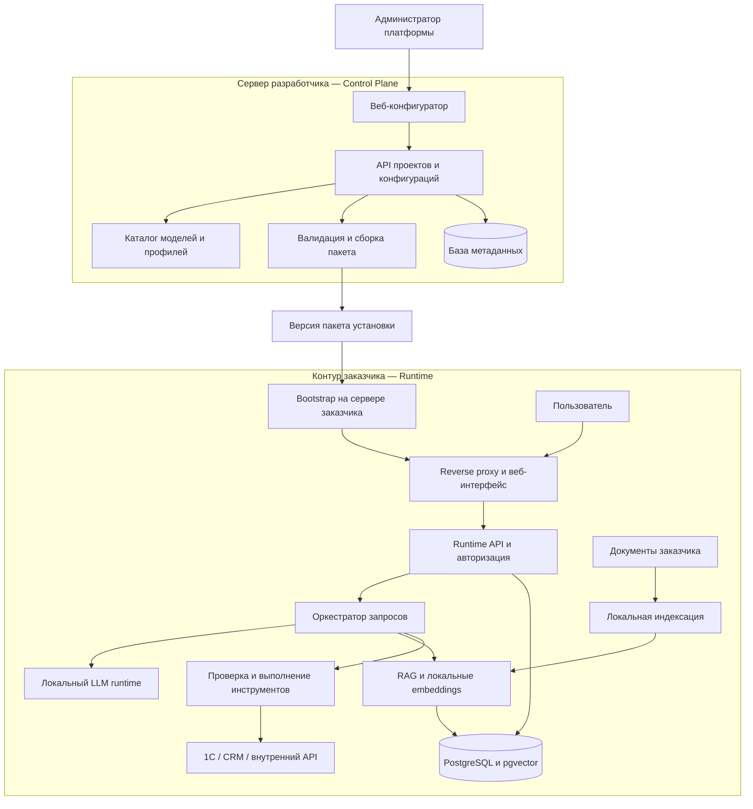
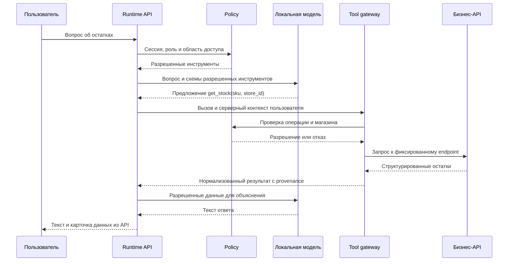

# Архитектура платформы

Дата: 19 октября 2026 года. Статус: предлагаемая архитектура MVP, требующая проверки экспериментами. Технологические возможности сверены с официальными источниками; выбор компонентов, ограничения и численные настройки ниже являются проектными решениями.

## 1. Назначение и формулировка темы

Рекомендуемая тема: **«Разработка платформы конфигурации и автоматизированного развертывания локальных RAG-ассистентов с интеграцией корпоративных API»**.

Эта формулировка покрывает и поиск по документам, и получение оперативных данных через инструменты. «Программно-аппаратный комплекс» уместен, если работа действительно включает собственную аппаратную часть или поставляемый аппаратный стенд. Для платформы с рекомендацией оборудования первая формулировка точнее.

Результат для заказчика — автономно работающий стек ассистента и воспроизводимый пакет его установки. Продуктовая ценность платформы: перевод бизнес-требований в проверяемую конфигурацию, подбор из протестированного каталога и доставка работающей системы в контур клиента.

Исследовательская гипотеза: ограниченный декларативный контракт и проверенные профили развертывания позволяют уменьшить время установки и количество ручных ошибок при сохранении заданного качества бизнес-сценариев. Гипотеза проверяется сравнением с ручным развертыванием, а не объявляется доказанной заранее.

## 2. Что означает «настроить модель»

В первой версии это конфигурация поведения системы:

- системные инструкции и область применения;
- доступные инструменты и схемы их аргументов;
- документы, правила поиска и ссылки на источники;
- роли и ограничения доступа;
- модель, квантование, контекст, параметры генерации;
- ресурсы, ограничения нагрузки и способ установки.

Дообучение весов не требуется для подключения документов или API и остается за пределами MVP. RAG, вызовы инструментов и fine-tuning — разные механизмы.

**RAG** нужен для регламентов, инструкций и описаний. **Инструменты** нужны для текущих остатков, цен, поставщиков и отчетов. Оперативные остатки не следует выдавать из давно построенного векторного индекса.

Модель предлагает операцию и аргументы. Приложение определяет, можно ли ее выполнять, вызывает источник и контролирует результат. Function Calling не превращает выбор модели в детерминированный алгоритм и не устраняет все ошибки ответа. Ollama предоставляет протокол для таких вызовов и возврата результатов в диалог. [Документация Ollama](https://docs.ollama.com/capabilities/tool-calling).

## 3. Допущения MVP

- Разработка возможна на Windows; целевая установка — Linux x86-64 с Docker Engine и Compose. WSL2 можно использовать как среду разработки, но эталонные испытания провести на Linux.
- Одна установка Runtime обслуживает одну организацию. Общая база Runtime для нескольких заказчиков не используется.
- Профили: CPU для минимальной демонстрации и один конкретный NVIDIA-стенд для измерений. Поддержка NVIDIA требует проверки драйвера и контейнерного доступа к GPU. [Docker: GPU в Compose](https://docs.docker.com/compose/how-tos/gpu-support/).
- Начальные сетевые операции — загрузка образов и моделей. После подготовки артефактов бизнес-запросы выполняются локально.
- Источники бизнес-данных доступны из сети Runtime. Изолированному серверу без маршрута к 1С потребуется настроенная заказчиком сеть или шлюз.
- Первый интеграционный контракт содержит три операции чтения. Реальная 1С подключается под одну согласованную конфигурацию и версию.
- Производственные SLA, стоимость аренды и точные требования к железу определяются после замеров.

## 4. Два контура



Стрелка доставки пакета относится к установке и обновлению. Во время чата обязательного обращения к Control Plane нет.

| Данные | Control Plane | Runtime |
|---|---|---|
| Организация, проект, версии шаблонов | Да | ID установленного проекта и версия |
| Параметры модели и декларация сценариев | Да | Да |
| Адреса внутренних источников | По возможности placeholders | Реальные адреса в локальном overlay |
| Пароли, API-токены и ключи 1С | Нет | Локальные secret-файлы |
| Документы и embeddings | Нет | Да |
| Диалоги и результаты инструментов | Нет | Да |
| Hardware probe | Обезличенный отчет по желанию | Полный локальный результат |
| Состояние установки и диагностика | Только явно экспортируемые данные | Полные локальные данные |

Внешняя панель не должна проверять внутренний endpoint клиента из своего облака: такой адрес может быть недоступен, а проверка потребовала бы передачи учетных данных. Проверку соединения выполняет локальная утилита или локальный кабинет Runtime.

## 5. Продуктовые сценарии

### 5.1. Конфигурация и установка

1. Создать организацию, проект и версию ассистента.
2. Выбрать сценарии: документы, остатки, поставщики, отчетность.
3. Назначить роли, источники и операции из разрешенных шаблонов.
4. Указать параметры целевого сервера или импортировать результат локального probe.
5. Получить предварительные профили с указанием, какие из них уже измерены.
6. Проверить конфигурацию и скачать пакет установки.
7. На сервере заказчика задать реальные адреса и секреты, выполнить preflight.
8. Загрузить артефакты, запустить стек, провести локальный smoke test.
9. Получить адрес кабинета и результат приемки. Не публиковать интерфейс в Интернет автоматически.

### 5.2. Остатки для клиента

Запрос: «Есть ли товар SKU-001 в магазине 3?»

Модель предлагает `get_stock` с SKU и магазином. Runtime проверяет право пользователя, разрешенный магазин и схему аргументов. Коннектор получает актуальные остатки. Ответ показывает товар, магазин, количество, источник и время получения данных. При нескольких совпадениях товар уточняется; при недоступности источника система сообщает об этом.

### 5.3. Отчет для менеджера

Запрос: «Покажи выручку за прошлый месяц по магазину 3».

Runtime проверяет право на отчет и магазин, определяет календарный период в часовом поясе организации и вызывает `get_sales_report`. Точные периоды отображаются пользователю. Выручку, возвраты и итоги рассчитывает учетная система или серверный модуль с Decimal; модель только объясняет полученные показатели. Числовая таблица строится непосредственно из структурированного ответа API.

Термин «финансовый отчет» в MVP означает заранее определенный отчет по продажам с описанными правилами расчета, а не произвольную бухгалтерскую отчетность или независимую финансовую оценку.

### 5.4. Вопрос по документам

Запрос: «Какие условия возврата действуют для этого товара?»

Runtime ищет доступные пользователю фрагменты актуальных документов, передает их модели и показывает ссылки на документ, раздел или страницу. При отсутствии надежного источника отвечает, что данных недостаточно.

## 6. Технологический стек

| Слой | Выбор для MVP | Причина |
|---|---|---|
| Backend Control Plane и Runtime | Python, FastAPI, Pydantic | Общие типы конфигурации, API и инструменты обработки данных |
| UI | React, TypeScript, Vite | Конфигуратор и локальный кабинет с общими компонентами |
| Данные | Отдельный PostgreSQL в каждом контуре | Метаданные и транзакции без переноса клиентских данных в CP |
| Векторный поиск | pgvector в Runtime DB | Один движок для документов, прав и векторов |
| Инференс | Ollama, локальный режим | Первый проверяемый адаптер и управление локальными моделями |
| Embeddings | Локальный sentence-transformers worker | Независимая от генеративной модели индексация |
| Фоновые задания | Worker из того же Python-пакета и таблица jobs | Без Redis для небольшого MVP; lease и повторное получение задач после сбоя |
| Поставка | Docker Compose, CLI bootstrap | Одна проверенная топология на одном сервере |
| Вход в Runtime | Локальные учетные записи и серверные сессии | Без зависимости от внешнего IdP; OIDC добавить позже |
| HTTP вход | Caddy или Nginx, выбрать один до реализации | Единый origin для UI/API, TLS из инфраструктуры клиента |

### 6.1. Ollama, llama.cpp и vLLM

| Движок | Роль в проекте | Что проверить |
|---|---|---|
| Ollama | Реализовать первым | Tool calling конкретной модели, квантование, контекст, расход памяти |
| llama.cpp | Исследуемая альтернатива для CPU/GGUF и управления низким уровнем | Формат шаблонов и инструментов, ресурсы, сборка под стенд |
| vLLM | Следующий кандидат для GPU и конкурентной нагрузки | Поддержку конкретной модели, parser инструментов, GPU и выигрыш на нагрузке |

llama.cpp предоставляет локальный сервер и несколько аппаратных backend; vLLM предоставляет HTTP API, совместимый с частью OpenAI API. Совместимость транспорта сама по себе не гарантирует одинакового поведения инструментов. [llama.cpp](https://github.com/ggml-org/llama.cpp), [vLLM](https://docs.vllm.ai/en/latest/serving/online_serving/openai_compatible_server/).

У Runtime должен быть внутренний интерфейс `LLMProvider`: `capabilities`, `chat`, `stream`, `health`, `model_info`. В MVP реализуется один провайдер. Адаптер нормализует tool calls, usage, ошибки и завершение потока.

### 6.2. RAG-фреймворки

Для первоначального pipeline достаточно явных модулей загрузки, chunking, embeddings, retrieval и подготовки контекста. Это облегчает измерение каждого этапа и проверку прав.

На аналитическом этапе сравнить LlamaIndex и Haystack с прямой реализацией по одинаковым критериям: локальная работа, ACL, контроль версий индекса, доступ к промежуточным результатам, поддерживаемость и сложность зависимостей. Не внедрять одновременно несколько фреймворков. Выбор подтвердить коротким spike и ADR; текущая рекомендация — простой явный pipeline.

## 7. Модули и границы ответственности

Это модульный монолит в каждом контуре, а не набор микросервисов. API и worker могут быть разными процессами одного приложения.

### 7.1. Control Plane

- **Projects**: организации, участники, проекты, версии конфигурации.
- **Configurator**: мастер сценариев, роли, источники, шаблоны инструментов.
- **Catalog**: разрешенные модели, лицензии, артефакты, проверенные комбинации.
- **Recommender**: предварительный отбор и ранжирование измеренных профилей.
- **Validator**: синтаксические и смысловые проверки конфигурации.
- **Bundle builder**: разрешение зависимостей, генерация Compose, lock и инструкций.
- **Distribution**: хранение пакетов и, позже, выдача ограниченных установочных приглашений.

### 7.2. Runtime

- **Identity and policy**: локальные пользователи, роли и область доступа.
- **Conversations**: диалоги, сообщения, история источников и запросов.
- **Orchestrator**: выбор режима, сбор контекста, ограниченный цикл инструментов.
- **Tool gateway**: проверка политик, схем, адресов и выполнение HTTP-запросов.
- **Connectors**: перевод бизнес-контракта в конкретное API.
- **Knowledge**: загрузка, индексация, поиск, версии и удаление документов.
- **LLM provider**: адаптер к Ollama.
- **Jobs**: индексация, проверка соединений и служебные задания.
- **Audit and diagnostics**: локальные события и метрики без обязательной отправки наружу.

Наблюдаемость, policy и коннекторы — логические модули. Отдельные сетевые сервисы нужны только там, где это дает измеримую пользу.

## 8. Декларативная конфигурация

Разделить четыре сущности:

1. `assistant.yaml` — желаемое поведение: сценарии, роли, инструменты, профиль ресурсов.
2. `customer.local.yaml` — локальные адреса источников, сертификаты и настройки контура.
3. `release.lock.json` — конкретные версии, digest образов, идентичность и хеши артефактов моделей, ревизия embedding-модели, версия схемы и шаблонов.
4. `secrets/` — значения секретов на сервере клиента, в пакет от разработчика не входят.

Сборщик преобразует декларацию в проверенный deployment plan, затем в Compose и конфигурацию Runtime. Произвольные контейнеры, shell-команды, Python-код и Jinja-выражения из пользовательского YAML не допускаются.

Контракт версионируется полем `apiVersion`. Неизвестные поля и версии отклоняются; конфигурация нормализуется в каноническую форму. Изменение параметров порождает новую ревизию, установленная ревизия остается неизменной.

**Проверки:** существование ссылок на роли и коннекторы; совместимость инструмента и адаптера; корректность схем аргументов; ограничения контекста; полнота секретных ссылок; отсутствие конфликтующих маршрутов и небезопасных mounts; соответствие профиля каталогу.

Предлагаемый [пример](../examples/retail-assistant.yaml) описывает эти идеи. Его поля еще должны получить строгую Pydantic/JSON Schema модель на первом этапе разработки.

### 8.1. Основные сущности данных

| Контур | Сущности |
|---|---|
| CP | Organization, Membership, Project, ConfigurationRevision, ModelArtifact, HardwareProfile, BenchmarkResult, BundleRelease |
| Runtime | User, Role, Permission, AssistantRevision, ConnectorConfig, SecretReference, Conversation, Message, ToolExecution, AuditEvent |
| Runtime RAG | Document, DocumentVersion, Chunk, EmbeddingIndexVersion, IngestionJob |

У документа и фрагмента хранятся область доступа, hash, версия и provenance. У каждого выполнения инструмента — инициатор, примененная политика, имя операции, статус, длительность и ID источника. Пароли и полные чувствительные ответы в аудит не копируются.

### 8.2. Предлагаемые API

| Контур | API | Назначение |
|---|---|---|
| CP | `POST /api/v1/projects` | Создание проекта |
| CP | `POST /api/v1/projects/{id}/revisions` | Сохранение ревизии |
| CP | `POST /api/v1/revisions/{id}/validate` | Проверка конфигурации |
| CP | `POST /api/v1/recommendations` | Отбор профилей |
| CP | `POST /api/v1/revisions/{id}/bundles` | Запуск сборки пакета |
| CP | `GET /api/v1/bundles/{id}` | Статус и метаданные артефакта |
| Runtime | `POST /api/v1/sessions` | Вход в локальный кабинет |
| Runtime | `POST /api/v1/conversations/{id}/messages` | Сообщение и SSE-поток событий |
| Runtime | `POST /api/v1/knowledge/documents` | Локальная загрузка документа |
| Runtime | `POST /api/v1/connectors/{id}/check` | Проверка доступности источника |
| Runtime | `GET /api/v1/jobs/{id}` | Состояние задания |
| Runtime | `GET /health/live`, `GET /health/ready` | Жизнеспособность и готовность |

Роли и scope берутся из серверной сессии. Нельзя доверять переданному клиентом `role`, `organization_id` или `store_id` без проверки. Все операции CP ограничены членством в организации, скачивание артефактов тоже.

## 9. Обработка запроса и инструменты



Предлагаемый интерфейс коннектора:

```text
Connector.check_connection(local_config, secret_reader)
Connector.execute(operation_id, validated_args, principal_context)
    -> ToolResult(data, source_id, fetched_at, status)
```

Реестр содержит доверенные адаптеры. Вызов неизвестного инструмента отклоняется. HTTP-метод, host, path template, схема результата и используемый секрет определяются конфигурацией адаптера, а не моделью.

Начальные лимиты для проверки: 4 итерации модели, 6 вызовов инструментов суммарно, 10 секунд на одно обращение к бизнес-API, 120 секунд на запрос целиком. Это стартовые настройки; изменить по результатам CPU/GPU испытаний. Нельзя обходить лимит созданием вложенного агента.

Параметры проходят строгую проверку типов и диапазонов. Даты преобразуются в явные интервалы; ID магазина сопоставляется с правами пользователя; размер ответа ограничивается. Повторить можно только безопасную операцию чтения при временной сетевой ошибке и в пределах общего дедлайна. Ошибки прав и схемы не повторяются.

Для запланированных операций интерфейс может иметь выделенные кнопки «Остатки» и «Отчет». Тогда операция выбирается приложением, а модель помогает заполнить параметры. Свободный чат использует модельный выбор инструмента. Эти режимы отдельно сравниваются при испытаниях.

Ответ содержит структурированную карточку источника независимо от текста модели. Для финансовых чисел и остатков карточка является основным представлением фактов. Нельзя гарантировать истинность произвольного сгенерированного пересказа только наличием Function Calling.

## 10. Интеграция с 1С и внутренними API

Первые операции:

| Операция | Аргументы | Результат | Доступ |
|---|---|---|---|
| `get_stock` | sku, store_id | Название, остаток, единица, магазин | customer, manager с разрешенным магазином |
| `get_suppliers` | product_id | Разрешенные сведения о поставщиках | manager с правом suppliers:read |
| `get_sales_report` | date_from, date_to_exclusive, store_id | Выручка, возвраты, сумма, валюта, правила расчета | manager с правом reports:read |

Роль admin отвечает за настройку и пользователей. Доступ к коммерческим данным ей автоматически не выдается; для него назначаются дополнительные права.

1С поддерживает стандартный REST-интерфейс на OData 3.0 и собственные HTTP-сервисы. [REST 1С](https://v8.1c.ru/platforma/rest-interfeys/), [HTTP-сервисы 1С](https://v8.1c.ru/platforma/http-servisy/).

**Путь MVP:** симулятор с фиксированным OpenAPI-контрактом → адаптер к одному опубликованному HTTP-сервису 1С. На стороне 1С специалист создает узкий endpoint для нужной бизнес-операции либо адаптер сопоставляет контракт с уже имеющимся API.

Стандартный OData — отдельный адаптер после первого пилота. Метаданные помогают узнать структуру объектов, но не объясняют автоматически, какие регистры и правила дают корректный бизнес-остаток или отчет. Доступы, публикация, расширение конфигурации и проверка расчета требуют участия администратора или разработчика 1С.

Симулятор необходим для воспроизводимой демонстрации, но не является доказательством совместимости с реальной 1С. При отсутствии доступа к 1С это ограничение явно указывается в дипломе.

Универсальный REST-коннектор в MVP настраивается разработчиком/интегратором: выбираются конкретные операции OpenAPI, указываются схемы и права. Автоматически открывать модели все операции загруженного OpenAPI нельзя.

## 11. RAG и управление знаниями

Pipeline: локальная загрузка → извлечение текста → нормализация → фрагменты → локальные embeddings → индекс → поиск с учетом прав → ограниченный контекст → ответ со ссылками.

Начальный embedding-кандидат: `intfloat/multilingual-e5-small`. Его карточка указывает размерность 384, предел 512 токенов и префиксы `query:` / `passage:` для поиска. Начальная настройка chunking: около 350 токенов с перекрытием 50, считая токенизатором embedding-модели и оставляя место для префиксов. Проверить это экспериментом. [Карточка модели](https://huggingface.co/intfloat/multilingual-e5-small).

Каждый фрагмент хранит `document_id`, версию, страницу/раздел, hash, ACL и ревизию embeddings. Поиск использует только активные версии и разрешенную область. Отзыв прав и удаление документа действуют также на скачивание оригинала, цитаты, кэш и историю выдачи.

Для небольшого набора начать с точного поиска pgvector и фильтра прав в запросе к БД. В prompt никогда не попадают недоступные фрагменты. При переходе на ANN отдельно проверить полноту результатов при фильтрации: приблизительный индекс может возвращать меньше подходящих строк. [Документация pgvector](https://github.com/pgvector/pgvector).

На старте: top-k=5 и ограничение общего контекста. Порог релевантности калибруется на размеченных примерах, а не выбирается как универсальное число. Поиск по артикулам и точным обозначениям дополнить полнотекстовым/лексическим поиском только если тесты показывают необходимость.

Новая версия документа индексируется отдельно и становится активной атомарно после успеха. Ошибка индексации не должна уничтожать рабочую предыдущую версию. Смена embedding-модели требует нового индекса; смешивать несовместимые векторы нельзя.

Локальный worker использует ограниченные CPU/RAM. Файлы имеют ограничения размера и типа; PDF без текстового слоя получает явный статус «требуется OCR». Документы и ответы API считаются данными, а содержащиеся в них инструкции не расширяют права модели.

## 12. Роли и безопасность исполнения

### 12.1. Авторизация

Права проверяются в трех местах: до выдачи инструментов модели, перед выполнением операции и при извлечении данных. Фильтрация списка инструментов улучшает поведение модели, но окончательным барьером является серверная проверка.

Пользователь видит только свои диалоги, если ему отдельно не выданы права просмотра. Аудит доступен ограниченной роли. Публичный доступ без входа не включается автоматически; демонстрационный customer — аутентифицированная роль.

Локальная аутентификация: хеширование паролей современным password hasher, сессии с отзывом, cookies HttpOnly/Secure/SameSite, CSRF-защита для изменяющих операций, ограничение попыток входа. Начальный пароль создается локально, постоянного общего пароля в образе нет.

### 12.2. Сеть и секреты

- Внешний вход — только через reverse proxy. PostgreSQL и Ollama не публикуют host-порты по умолчанию.
- API-коннектору разрешаются конкретные host, port, scheme и пути. Внутренние адреса допустимы, поскольку это назначение продукта; произвольный URL из чата недопустим.
- При разрешении имени проверяются целевые IP, редиректы запрещены либо проходят повторную проверку. Link-local, metadata endpoints и loopback разрешаются только отдельным обоснованным правилом администратора.
- HTTP-прокси и маршруты контролируются конфигурацией развертывания. Для строгого egress-контроля нужна политика на хосте или корпоративном шлюзе; одна Compose-сеть не является полноценным межсетевым экраном.
- LLM и embedding-worker не получают учетные данные 1С. Секреты получает только процесс, который выполняет интеграцию.
- Compose secrets монтируются отдельными файлами. Они не обеспечивают самостоятельное шифрование секрета на диске хоста; нужны права файловой системы и принятый у клиента способ защиты носителя. [Docker Compose secrets](https://docs.docker.com/compose/how-tos/use-secrets/).
- Приватные URL и токены не добавляются в prompt, browser logs, сообщения об ошибках и внешнюю телеметрию.

В Ollama предусмотрен локальный режим через `OLLAMA_NO_CLOUD=1`; включить его в профиль Runtime и отдельно проверить сетевое поведение всей установки. Отключение облачных функций одного компонента не доказывает отсутствие внешних обращений других процессов. [Ollama FAQ](https://docs.ollama.com/faq).

Защита от prompt injection строится на правах, фиксированных операциях и ограничениях исполнения. Системная инструкция — дополнительная мера, а не единственная защита.

Размещение on-premise определяет техническую границу обработки, но само по себе не подтверждает выполнение всех требований конкретной организации к данным и эксплуатации.

## 13. Подбор модели и оборудования

### 13.1. Входные данные

Типы задач, русский язык и терминология; необходимость инструментов; длина документов и контекста; ожидаемые активные запросы; максимальная приемлемая задержка; требования к качеству; CPU/RAM/GPU/VRAM/диск; бюджет как заданный пользователем параметр.

Каталог начинается с нескольких кандидатов, например `qwen3:1.7b-q4_K_M`, `qwen3:4b-instruct-2507-q4_K_M`, `qwen3:8b-q4_K_M`. Это фиксированный набор для сравнения, а не заявление о лучших моделях на рынке. Точные теги и артефакты проверяются перед включением в релиз. В реестре есть разные варианты Qwen3, поэтому один общий тег без фиксации артефакта недостаточен. [Каталог Ollama](https://ollama.com/library/qwen3/tags).

Для каждой записи: upstream и лицензия; идентификатор артефакта; квантование; совместимый provider; поддержанные инструменты; измеренный контекст и параллелизм; профиль оборудования; качество и задержки на тестовом наборе; дата испытаний.

### 13.2. Предварительная оценка

Грубая нижняя оценка размера весов плотной модели:

```text
weights_bytes ≈ parameter_count × effective_bits_per_weight / 8
```

Она не включает все метаданные квантования, KV-cache, runtime buffers и остальные сервисы. RAM и VRAM оцениваются отдельно с учетом CPU/GPU offload; размер файла модели не равен общему потреблению памяти.

KV-cache зависит от архитектуры, длины контекста, числа одновременно обрабатываемых последовательностей и формата хранения. Число зарегистрированных пользователей не равно числу конкурентных генераций. Ollama отдельно описывает влияние параллельных запросов и контекста на память. [Ollama FAQ](https://docs.ollama.com/faq).

В первой версии применять консервативные профили и измеренный запас памяти. Фиксированный множитель вроде «размер весов × 1,2» нельзя выдавать за универсальный расчет.

### 13.3. Алгоритм рекомендации

1. Отфильтровать по лицензии, возможностям, архитектуре и поддерживаемому backend.
2. Исключить очевидно неподходящие по RAM/VRAM, диску и контексту.
3. Для измеренных комбинаций проверить качество, TTFT и полную задержку под заданной нагрузкой.
4. Сформировать набор вариантов без доминирования по качеству и ресурсоемкости; предложить самый экономный, который проходит ограничения.
5. Неизмеренный вариант пометить как предварительный и запросить локальную калибровку.
6. При отсутствии проходящего кандидата сообщить об этом и предложить уменьшить нагрузку/контекст или изменить оборудование. Не подменять ограничение обещанием.

Итог: модель + backend + квантование + контекст + предел параллелизма + профиль железа + основание рекомендации. Аренда сервера и актуальные цены провайдеров не входят в MVP.

### 13.4. Локальная калибровка

Утилита собирает аппаратный отчет, запускает короткий набор задач, измеряет пиковую память и задержки и сохраняет отчет локально. Передача обезличенного отчета в CP — отдельное действие пользователя. По умолчанию тексты запросов, документы и ответы не экспортируются.

Небольшая модель может не пройти требования к русскому языку или выбору инструментов даже при достаточной памяти. В таком случае допустим более крупный кандидат или ограниченный сценарий с детерминированным выбором операции.

## 14. Пакет установки и жизненный цикл

Предлагаемая структура пакета:

```text
release/
  assistant.yaml
  customer.local.example.yaml
  release.lock.json
  compose.yaml
  runtime-config.json
  checksums.sha256
  release-signature
  INSTALL.md
  templates/
```

Пакет поставляет разрешенную топологию сервисов: proxy, Runtime API, worker, PostgreSQL+pgvector, Ollama и одноразовые init-задачи. UI может собираться в статические файлы proxy. Модель и embeddings сохраняются в локальных volumes. В реальном релизе образы фиксируются digest, веса и embeddings — точными артефактами и проверяемыми хешами; выдуманные digest в спецификации не используются.

Сначала реализовать скачиваемый архив и отдельную CLI-утилиту. Короткая ссылка — удобный способ получить тот же пакет, ее стоит добавить после стабильной установки из архива.

**Короткая ссылка:** ограниченное по времени приглашение к конкретной версии. GET показывает информацию, а обмен на доступ к скачиванию выполняется отдельным POST, чтобы предпросмотр ссылки не израсходовал приглашение. Токен не дает доступа к бизнес-API и не попадает в постоянные URL журналов. Владелец установки подтверждается согласно выбранному механизму доступа CP.

Подпись релиза проверяется ключом, доверие к которому установлено через отдельно полученную CLI или канал доставки. Подпись и ключ, скачанные только из одного непроверенного архива, не устанавливают доверие самостоятельно. Контрольная сумма обнаруживает повреждение, подпись подтверждает издателя.

### 14.1. Bootstrap

Предлагаемые будущие команды: `bootstrap inspect`, `bootstrap plan`, `bootstrap install`, `bootstrap status`, `bootstrap backup`. Это проект интерфейса, а не уже существующая утилита.

Последовательность установки:

1. Проверить совместимость ОС, Docker/Compose, свободные порты, RAM/VRAM, диск и доступ к GPU.
2. Проверить подпись, хеши, версии схемы и completeness lock-файла.
3. Собрать локальный overlay и ссылки на секреты; проверить доступность источников локально.
4. Показать план: сервисы, volumes, порты, загрузки и объем диска.
5. Загрузить и проверить модели/образы с возобновлением после обрыва.
6. Поднять БД и выполнить миграции, подготовить локальные модели и embeddings.
7. Дождаться готовности и выполнить smoke test авторизации, поиска и разрешенного инструмента.
8. Выдать адрес интерфейса и отчет. Статус «готово» допускается только после проверок.

Compose запускает зависимости по заданным условиям, но простой порядок старта не означает готовность БД или модели. Нужны healthchecks и ожидание успешного завершения init-задач. [Порядок запуска Compose](https://docs.docker.com/compose/how-tos/startup-order/).

### 14.2. Обновления и восстановление

Конфигурационные ревизии неизменяемы. Bootstrap хранит установленную и предыдущую версии. Повторный запуск установки использует существующие volumes и не дублирует документы/пользователей. Одновременные установки блокируются локальным lock.

Перед миграцией создается backup БД, конфигурации и локальных документов. Секреты резервируются по отдельной политике клиента. Проверка восстановления обязательна. Модель и индекс можно восстановить из зафиксированных артефактов и документов, но это занимает время.

Откат контейнеров допустим только при совместимости схемы БД. После несовместимой миграции требуется восстановление backup с учетом потери изменений после снимка; автоматический откат обещать нельзя. Для MVP выбирать обратно совместимые миграции.

Удаление установки сохраняет данные, пока администратор явно не выберет отдельную операцию очистки. Docker socket не монтируется в Runtime API; доступ к Docker нужен локальной утилите установки.

### 14.3. Работа без внешней связи

После загрузки артефактов Runtime должен обслуживать локальные сценарии при отключенном Интернете и недоступном CP. Внешние реестры, обновления, внешние DNS/IdP и проверка подписки не являются обязательными зависимостями каждого запроса.

Полностью offline-установка — отдельная последующая функция: export/import OCI-образов, весов, embeddings, лицензий, подписей и зависимостей для целевой архитектуры. Ее нельзя считать выполненной только наличием Compose-файла.

## 15. Структура будущего репозитория

```text
apps/
  control-api/
  control-web/
  runtime-api/
  runtime-web/
packages/
  contracts/          # декларации и нормализованные результаты
  policy/             # права и scope
  connectors/         # доверенные адаптеры
  llm/                # интерфейс provider и адаптер Ollama
  rag/                # обработка документов и retrieval
  deployment/         # planner и генератор пакетов
tools/
  bootstrap/
  business-api-simulator/
deploy/
  templates/
  model-catalog/
evaluation/
  fixtures/
  cases/
  reports/
docs/
  adr/
```

Это целевая структура. На 30 октября 2026 года текущий репозиторий содержит документацию, примеры декларации и [исполняемый CRUD-симулятор бизнес-API](../tools/business-api-simulator/README.md). Control Plane, Runtime, провайдер LLM и bootstrap еще не реализованы.

## 16. Что нужно уточнить перед реализацией

Для первого этапа достаточно узнать доступный CPU/RAM/GPU, срок диплома и возможность доступа к тестовой 1С. Архитектуру можно реализовывать с симулятором, но подтверждение реальной интеграции и выбор аппаратного профиля зависят от этих данных.

На раннем spike проверить три риска: качество выбранных малых моделей на русском языке; надежность tool calling под выбранным backend; корректность бизнес-контракта отчетов/остатков. Результаты определяют конфигурацию MVP до разработки полного веб-мастера.
