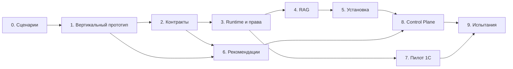

# Поэтапный план реализации

Статус на 30 октября 2026 года: реализован [CRUD-симулятор бизнес-API](../tools/business-api-simulator/README.md) с тремя операциями чтения; сквозной LLM-сценарий, Runtime и установщик еще предстоят. Оценка для одного разработчика, знакомого с Python и веб-разработкой: **примерно 10–14 недель полной занятости** до дипломного прототипа. Это ориентир, а не обязательство. Изучение стека с нуля, ограниченная занятость, отсутствие GPU или ожидание доступа к 1С увеличат срок. Промышленная эксплуатация потребует отдельного этапа.

Этапы 0–2 проверяют техническую осуществимость. Этапы 3–6 доводят систему до воспроизводимой поставки. Этапы 7–9 дают интеграцию, интерфейс и измеримые результаты для защиты.

## Этап 0. Зафиксировать сценарии и стенд

Ориентир: 2–3 рабочих дня.

**Работа:**

- Записать три демонстрационных сценария: условия возврата по документам, остатки по магазинам, отчет по продажам.
- Описать терминологию: что означает остаток, какие суммы входят в выручку, как учитываются возвраты, валюта, timezone и границы периода.
- Определить роли, права и доступные магазины; подготовить тестовых пользователей.
- Зафиксировать доступное оборудование и целевую Linux-среду.
- Подготовить небольшой набор синтетических товаров, поставщиков, продаж и документов без реальных персональных данных.
- Начать аналитическую главу: конкурирующие подходы, Ollama/llama.cpp/vLLM, варианты RAG, критерии сравнения.

**Результат:** краткое ТЗ, контракт сценариев, данные стенда, первые ADR.

**Приемка:** для каждого сценария есть конкретный вход, ожидаемый источник, правильный результат и допустимая роль. Известно, на каком железе проводить первый запуск.

## Этап 1. Вертикальный прототип tool calling

Ориентир: 4–6 дней. Зависит от этапа 0.

**Работа:**

- Создать Python-приложение Runtime с health endpoint.
- Поднять Ollama и один небольшой кандидат из каталога; записать точный артефакт.
- Реализовать симулятор операции `get_stock` и нормализованный `ToolResult`.
- Реализовать адаптер провайдера, реестр инструментов, проверку аргументов и ограниченный цикл вызовов.
- Подключить минимальную серверную идентичность тестового пользователя и проверку scope. Временная тестовая идентичность допустима только в закрытом harness, не как публичный API.
- Сделать простой интерфейс или CLI для запроса и вывода структурированного результата.
- Сравнить 2–3 размера модели на небольшом наборе вопросов до выбора основного кандидата.

**Результат:** вопрос об остатках доходит до бизнес-API, ответ содержит реальные данные из симулятора и provenance.

**Приемка:** неизвестный инструмент, чужой магазин и некорректные аргументы отклоняются; таймаут источника не превращается в выдуманное число. Есть измерения задержки и памяти, а не только успешный скриншот.

**Точка решения:** если маленькая модель не справляется, проверить более крупную либо ограничить интерфейс сценариями с выбором операции приложением. Зафиксировать этот выбор до реализации конфигуратора.

## Этап 2. Контракты и тестовый набор

Ориентир: 3–4 дня. Зависит от этапа 1.

**Работа:**

- Формализовать YAML в Pydantic/JSON Schema; использовать запрет неизвестных полей и versioned `apiVersion`.
- Описать источники, роли, permissions, operations, secret refs, profile и ограничения запросов.
- Разделить переносимую декларацию, локальный overlay и lock-файл.
- Определить контракт ошибок и событий SSE; явно ограничить размеры данных.
- Расширить симулятор до поставщиков и отчетов; добавить ошибки, пустые данные и неоднозначный товар.
- Подготовить development-набор и отдельный holdout-набор из [методики испытаний](evaluation.md).
- Провести короткое сравнение прямого RAG pipeline и одного фреймворка; сохранить ADR.

**Результат:** строгий контракт, схема конфигурации и детерминированный симулятор трех операций.

**Приемка:** конфигурация с неизвестной ролью, конфликтом scope, неподдерживаемым backend или разрешением несуществующей операции не проходит валидацию. Отчеты симулятора сверяются с расчетом по фиксированным fixtures.

## Этап 3. Runtime, пользователи и аудит

Ориентир: 5–7 дней. Зависит от этапа 2.

**Работа:**

- Подключить PostgreSQL, миграции и локальные сессии.
- Реализовать роли admin/manager/customer и атрибуты доступа к магазинам.
- Добавить диалоги, сообщения и историю источников с серверной проверкой доступа.
- Реализовать все три операции в tool gateway, схему результатов, deadlines и ограничения повторов.
- Выводить финансовые таблицы и остатки из структуры API, а не из свободного текста модели.
- Сохранять аудит операций без токенов и лишних бизнес-данных.
- Реализовать состояния интерфейса: выполняется, источник недоступен, данных нет, доступ запрещен, нужно уточнение.

**Результат:** локальный ассистент с тремя ролями и проверяемым выполнением инструментов.

**Приемка:** прямой вызов Runtime API не позволяет обойти права UI. Customer не получает поставщиков, финансовый отчет или чужой диалог. Данные запрещенной операции не передаются модели даже при просьбе пользователя «игнорировать ограничения».

## Этап 4. Локальная база знаний

Ориентир: 5–7 дней. Зависит от этапа 3.

**Работа:**

- Добавить локальную загрузку TXT, Markdown и PDF с текстовым слоем.
- Реализовать извлечение, chunking, локальные embeddings и точный поиск pgvector.
- Добавить фоновые задания с lease, статусом и повторной обработкой после сбоя.
- Ввести версии документов/индексов и ACL, связывающие фрагменты с разрешенными пользователю областями.
- Реализовать цитаты, открытие разрешенного оригинала, замену документа и удаление.
- Выделить тесты на отсутствие источника и инъекцию инструкции внутри документа.

**Результат:** второй тип обработки запросов — поиск по документам с источниками.

**Приемка:** ответ по возвратам ссылается на нужную версию регламента. Manager-only документ не попадает в выдачу customer, в prompt и в скачиваемые цитаты. После удаления документ больше не участвует в поиске. PDF без текстового слоя получает понятный отказ.

## Этап 5. Пакет установки и bootstrap

Ориентир: 6–8 дней. Зависит от этапов 2–4.

**Работа:**

- Упаковать Runtime и worker, подготовить разрешенные Compose-шаблоны.
- Реализовать planner и builder: декларация → разрешенные версии → lock → пакет.
- Фиксировать образы по digest, модели/embeddings по ревизиям и хешам; запретить неполные release lock.
- Реализовать локальные overlays и secret-файлы.
- Добавить bootstrap preflight, plan, install, status и backup.
- Настроить healthchecks, одноразовые миграции/init и проверку готовности.
- Реализовать подпись релизного пакета и проверку через заранее доверенный ключ.
- Проверить повторную установку, восстановление после обрыва загрузки, резервное копирование и восстановление.

**Результат:** автономно запускаемый пакет, устанавливаемый на чистую эталонную машину.

**Приемка:** установка проходит по инструкции без ручного редактирования исходного кода; пользователю нужны только локальные значения и секреты. Повторный запуск сохраняет данные. Отключение CP и внешнего Интернета после загрузки артефактов не ломает локальные сценарии.

Не начинать с короткой ссылки и удаленной команды установки: сначала доказать установку из локального проверенного архива.

## Этап 6. Каталог моделей и рекомендации

Ориентир: 4–6 дней. Зависит от этапов 1–2 и рабочего Runtime.

**Работа:**

- Завести небольшой каталог с лицензиями, идентичностью артефактов, возможностями и статусом испытаний.
- Реализовать локальный hardware probe без автоматической передачи наружу.
- Реализовать предварительные оценки памяти и отбор несовместимых профилей.
- Связать измерения качества/скорости с точным оборудованием, контекстом и конкурентностью.
- Добавить объяснение рекомендации и статус «нужна калибровка» для непроверенных комбинаций.
- Обрабатывать ситуацию, когда ни один кандидат не удовлетворяет требованиям.

**Результат:** объяснимая рекомендация профиля, основанная на ограничениях и локальных измерениях.

**Приемка:** рекомендация воспроизводится на фиксированном каталоге и входе. Система различает «веса помещаются», «профиль проверен» и «заданный SLA выполнен». Неизмеренному серверу не приписывается гарантированная скорость.

## Этап 7. Один пилотный коннектор 1С

Ориентир: 3–6 дней при готовом доступе и участии специалиста 1С. Зависит от этапов 2–3; доступ следует запросить заранее.

**Работа:**

- Зафиксировать конфигурацию и версию 1С, опубликованный сервис, учетную запись и права.
- Сопоставить три операции с бизнес-логикой этой установки.
- Проверить реальные ответы, даты, decimal-поля, единицы, pagination и ошибки.
- Сверить остатки и отчет с эталонным представлением в самой 1С.
- Заменить симулятор адаптером без изменения оркестратора и UI.

**Результат:** подтвержденная интеграция с одной конкретной установкой 1С и описание границ совместимости.

**Приемка:** одинаковые бизнес-запросы дают согласованный результат в Runtime и контрольном отчете 1С; права сохраняются. Если стенда нет, этап отмечается как невыполненный, а демонстрация честно использует симулятор.

## Этап 8. Control Plane и конфигуратор

Ориентир: 6–9 дней. Зависит от этапов 2, 5–6.

**Работа:**

- Создать CP API и отдельную базу метаданных, авторизацию владельцев организаций.
- Реализовать проекты и неизменяемые ревизии.
- Собрать мастер: сценарии → роли → источники → оборудование → профиль → проверка → пакет.
- Сделать локальные placeholders для адресов и секретов, чтобы CP не требовал их значений.
- Добавить статусы сборки и скачивание только для владельца проекта.
- Довести локальный кабинет Runtime: чат, документы, подключения, пользователи и журнал.
- Если остается время, добавить короткое установочное приглашение с TTL и отзывом.

**Результат:** пользовательский путь от настройки ассистента до установки сгенерированного пакета.

**Приемка:** изменение сценария создает новую конфигурацию и пакет; старый пакет остается воспроизводимым. Пользователь одной организации не может получить чужую ревизию или архив по ID.

## Этап 9. Испытания и дипломная демонстрация

Ориентир: 5–7 дней. Зависит от законченных функций MVP.

**Работа:**

- Провести эксперименты по [методике](evaluation.md), сохранив сырые обезличенные результаты и версии артефактов.
- Сравнить ручную и автоматизированную установку на одинаковом стенде.
- Измерить качество RAG и инструментов, ресурсы, задержки и восстановление.
- Устранить обнаруженные дефекты, повторяя только затронутые проверки.
- Подготовить таблицы результатов, диаграммы и ограничения исследования.
- Записать демонстрацию: сборка конфигурации → установка → три сценария → отказ по правам → работа без CP.

**Результат:** работающий прототип и воспроизводимые основания для выводов диплома.

**Приемка:** достигнуты заранее зафиксированные критерии или явно объяснены недостигнутые; выводы не выходят за пределы использованного стенда и выборки.

## Порядок зависимостей

Стрелки показывают зависимости, а не обязательную параллельную работу. При одном разработчике этапы выполняются последовательно с ранней подготовкой доступа к 1С. Если пилот недоступен, финальные испытания прототипа проводятся на симуляторе с явно зафиксированным ограничением.

## Минимальная комплектация для защиты

1. Конфигуратор сохраняет проверенную декларацию ассистента.
2. Генератор выпускает пакет с зафиксированными версиями.
3. Bootstrap устанавливает локальный стек на эталонный сервер.
4. RAG отвечает по документам и показывает источники.
5. Инструменты получают остатки, поставщиков и отчет из симулятора либо подтвержденного адаптера.
6. Роли ограничивают документы, магазины и операции на сервере.
7. Рекомендация модели объясняет измеренные и предполагаемые характеристики.
8. Есть результаты измерений и сравнение времени установки.

При сокращении срока сначала исключить короткую ссылку, расширенный визуальный редактор, второй backend, универсальный OData и оформление кабинета. Сохранить реальные права, воспроизводимую установку, измерения и честное указание режима интеграции.

## После дипломного MVP

Пилот с одной организацией → эксплуатационное тестирование и обновления → OIDC и корпоративные политики → новые проверенные коннекторы → пакет для полностью offline-установки → профиль vLLM/масштабирование при подтвержденной нагрузке → биллинг и каталог интеграций.

Перед коммерческой поставкой отдельно оценить threat model реального клиента, восстановление, поддержку версий, лицензии поставляемых артефактов и процесс сопровождения. Это следующий объем работ, а не обещание готовности MVP к любой производственной среде.
